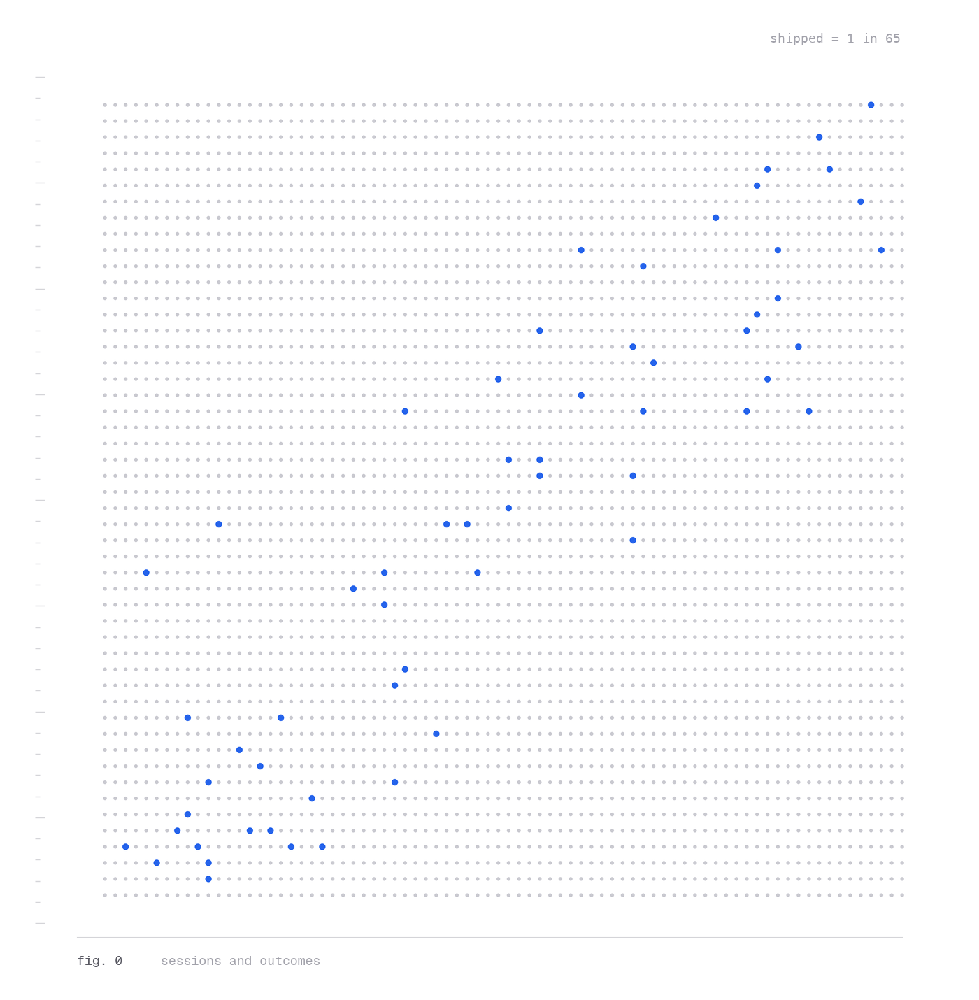
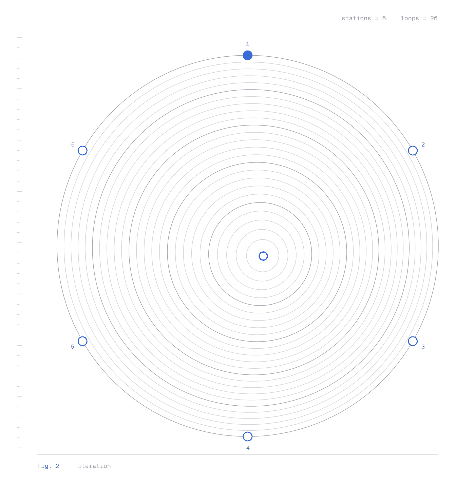
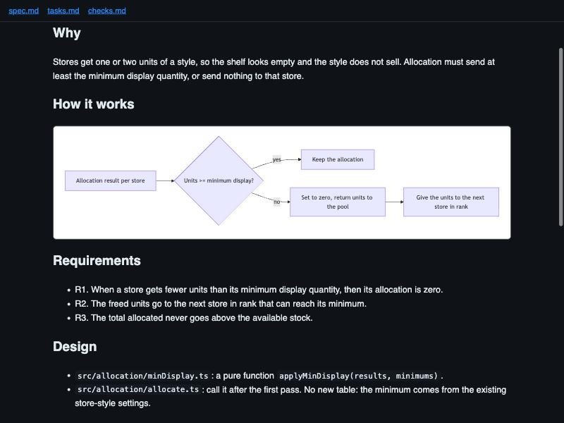
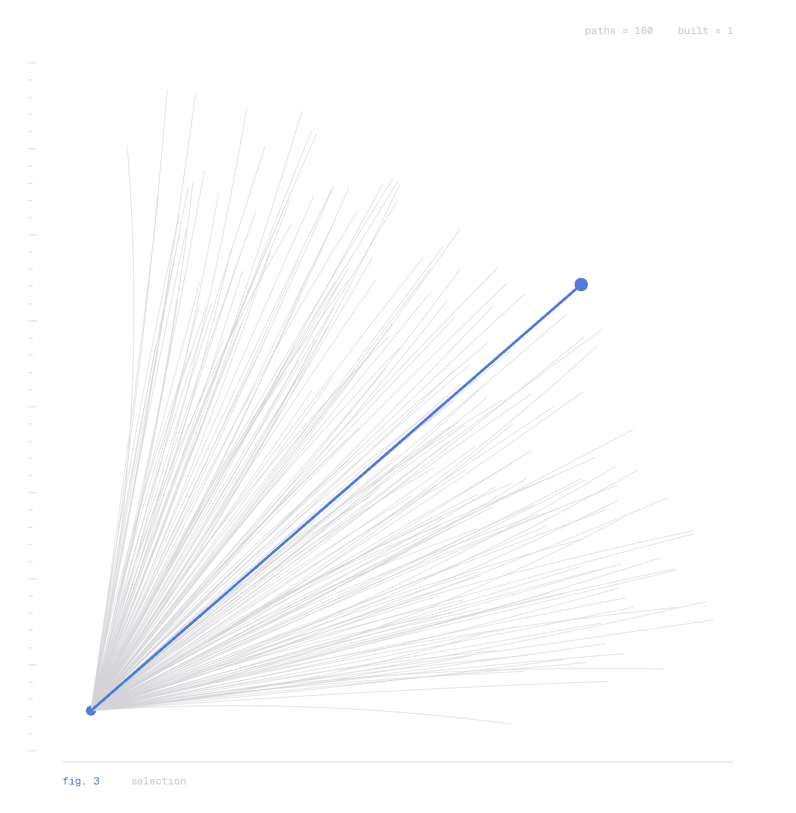
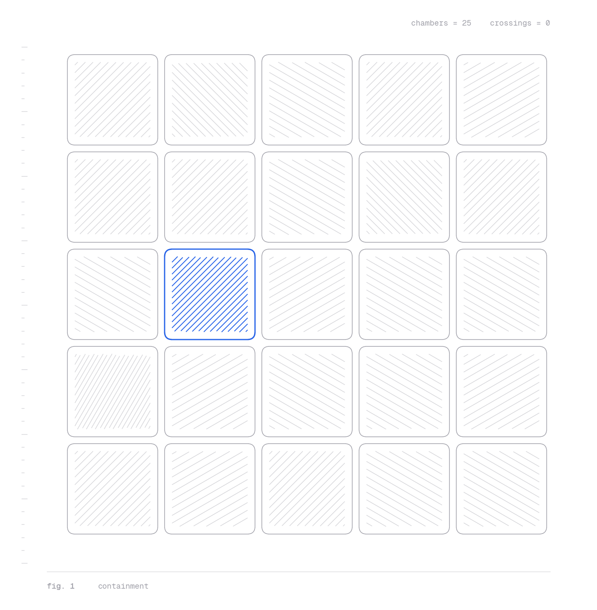

<!--
Slide deck (`layout: deck`): this body is raw HTML, not Markdown, rendered by DeckContent.
Each

<section class="slide"> is one slide; data-part groups slides into parts, and divider
slides carry data-tab for the part tabs. Slide titles are h2.hero, because the page's only h1
is the deck title (scripts/prerender.mjs counts the h1 tags, comments included). Colours use the --dk-* tokens defined under .deck in src/index.css.
Figures live in public/images/blog/building-with-claude/. Fig. 0 is redrawn from the deck's figure
with a ratio-preserving dot field (3,900 dots, 60 blue = 1 in 65), so it carries no raw team counts.
-->

<section class="slide title-slide active" data-part="0" aria-label="Title">
  

    Training series
    

      <h2 class="hero">Building with Claude</h2>
      
Practices, guardrails and habits for shipping faster without lowering the bar.

    

    

      
Part 1<b>Engineering workflow</b>

      
Part 2<b>Using Claude well</b>

      
Part 3<b>Beyond code</b>

      
Part 4<b>Guardrails and mindset</b>

    

  

  <figure class="plate"><figcaption><b>Fig. 0</b>Each dot stands for a Claude Code session my team ran; about 1 in 65 became a pull request (blue). This series is about turning more grey into blue.</figcaption></figure>
</section>

<section class="slide" data-part="0" aria-label="What we do today">
  <h2>What we do today</h2>
  
One story: from an idea to a merged pull request, with Claude doing the typing and you doing the thinking.

  

    

      
Part 1
The workflow

Spec-driven: plan the change as a spec, build it in small slices, prove it, ship it.

      
Part 2
Using Claude well

Set Claude up to run that workflow: context, instruction files, skills and review.

      
Part 3
Beyond code

Decide what to build, use Claude outside code, and ship through git.

      
Part 4
Guardrails

Protect data and tenants. Own what ships. Three things to do this week.

    

  

</section>

<section class="slide" data-part="0" aria-label="Where we are">
  <h2>Where we are today</h2>
  
My team's Claude usage in one month.

  

    

      

~92%

of the team uses Claude Code

      

1 in 65

sessions became a pull request

      

~43%

use Claude beyond code

    

    
We use Claude a lot. The gap is turning sessions into reviewed, shipped changes, and using it beyond code.

  

</section>

<!-- ============ PART 1 ============ -->

<section class="slide divider" data-part="1" data-tab="Engineering" aria-label="Part 1">
  

    
Part 1

    <h2 class="hero">Engineering workflow</h2>
    
From intent to a merged PR

    <ul class="covers">
      <li>Why plan first</li>
      <li>The plan is the spec: specify, plan, tasks</li>
      <li>The loop: approve, build, test, review</li>
      <li>Small slices, good tests, clear rules</li>
      <li>One folder per change, then the PR</li>
      <li>Turn mistakes into rules</li>
    </ul>
  

  <figure class="plate"><figcaption><b>Fig. 1</b>The six stations on the outer ring are our workflow steps, from plan to PR. Each inner ring is another pass through the loop, tightening toward a clean result.</figcaption></figure>
</section>

<section class="slide" data-part="1" aria-label="AI amplifies your process">
  <h2>AI amplifies whatever process you already have</h2>
  

    

      <svg class="dia" viewBox="0 0 760 290" role="img" aria-label="A clear process through AI gives better work faster; a messy process through AI gives tech debt faster">
        <defs><marker id="m2" viewBox="0 0 10 10" refX="9" refY="5" markerWidth="8" markerHeight="8" orient="auto"><path d="M0,0 L10,5 L0,10 z" style="fill:var(--dk-rule)"/></marker></defs>
        <rect x="0" y="20" width="230" height="90" rx="14" style="fill:var(--dk-soft);stroke:var(--dk-line)"/>
        <text class="t" x="115" y="60" text-anchor="middle">Clear process</text>
        <text class="s" x="115" y="86" text-anchor="middle">plan, tests, review</text>
        <line class="ln" x1="238" y1="65" x2="282" y2="65"/>
        <polygon points="285,25 285,105 375,65" stroke-width="2" style="fill:var(--dk-accent-soft);stroke:var(--dk-accent)"/>
        <text x="314" y="72" font-size="19" font-weight="700" style="fill:var(--dk-accent)">AI</text>
        <line class="ln" x1="380" y1="65" x2="460" y2="65" marker-end="url(#m2)"/>
        <rect x="470" y="20" width="290" height="90" rx="14" style="fill:var(--dk-do-soft);stroke:var(--dk-do-line)"/>
        <text x="615" y="60" text-anchor="middle" font-size="21" font-weight="650" style="fill:var(--dk-do)">Better work, faster</text>
        <text class="s" x="615" y="86" text-anchor="middle">quality compounds</text>

        <rect x="0" y="180" width="230" height="90" rx="14" style="fill:var(--dk-soft);stroke:var(--dk-line)"/>
        <text class="t" x="115" y="220" text-anchor="middle">Messy process</text>
        <text class="s" x="115" y="246" text-anchor="middle">no plan, no tests</text>
        <line class="ln" x1="238" y1="225" x2="282" y2="225"/>
        <polygon points="285,185 285,265 375,225" stroke-width="2" style="fill:var(--dk-accent-soft);stroke:var(--dk-accent)"/>
        <text x="314" y="232" font-size="19" font-weight="700" style="fill:var(--dk-accent)">AI</text>
        <line class="ln" x1="380" y1="225" x2="460" y2="225" marker-end="url(#m2)"/>
        <rect x="470" y="180" width="290" height="90" rx="14" style="fill:var(--dk-dont-soft);stroke:var(--dk-dont-line)"/>
        <text x="615" y="220" text-anchor="middle" font-size="21" font-weight="650" style="fill:var(--dk-dont)">Tech debt, faster</text>
        <text class="s" x="615" y="246" text-anchor="middle">problems compound too</text>
      </svg>
      <ul class="notes">
        <li>Speed isn't free. If you ship faster, you also need to catch problems faster.</li>
        <li>The fix is better structure and clearer constraints, not more AI.</li>
        <li>These practices work together: clear scope, evidence, review and accountability.</li>
      </ul>
    

  

</section>

<section class="slide" data-part="1" aria-label="Time shift">
  <h2>The work moves to design and review</h2>
  
Claude writes code quickly, but it can't fix a bad design. Spend the time you save on the plan and the review.

  

    

      

        
Before AI

        
DesignWriting codeReview

      

      

        
With AI

        
Design and planningCodeReview and testing

      

    

    
Illustrative split. Your numbers will vary; the direction won't.

  

</section>

<section class="slide" data-part="1" aria-label="Plan before you code">
  <h2>Plan before you code: the plan is the spec</h2>
  
Spec-driven development: agree on the intent first. The code is built from it and checked against it.

  

    

      

Prompt
<pre>Read src/allocation/ and its tests.
Do not write or edit any code yet.

Plan a minimum display quantity check
for allocation, as a spec:
- why, and testable requirements
- the files you will change, and why
  (open each file and confirm it exists)
- tasks, each with its tests
- open questions and assumptions

Wait for my approval before implementing.</pre>

      <ul class="notes">
        <li>Use plan mode, so nothing is edited while you agree on the approach.</li>
        <li>Never propose changes to code you haven't read.</li>
        <li>Challenge the plan. It's cheaper to fix a plan than a diff.</li>
        <li>Without a spec, the "why" stays in a chat that is gone tomorrow.</li>
      </ul>
    

    
GitHub Spec KitOpenSpecAWS Kiro

    
Public tools for the same method. Claude Code plan mode does it with no extra tool.

  

</section>

<section class="slide" data-part="1" aria-label="The loop">
  <h2>The loop, every time</h2>
  

    <svg class="dia" viewBox="0 -60 1000 300" role="img" aria-label="Specify, plan, tasks, check the spec, approve, build one slice, test, review, PR, with review looping back to specify">
      <defs><marker id="m4" viewBox="0 0 10 10" refX="9" refY="5" markerWidth="8" markerHeight="8" orient="auto"><path d="M0,0 L10,5 L0,10 z" style="fill:var(--dk-accent)"/></marker></defs>
      <path d="M834,58 C774,-45 110,-45 50,58" stroke-width="2" stroke-dasharray="6 6" fill="none" marker-end="url(#m4)" style="stroke:var(--dk-accent)"/>
      <rect x="290" y="-42" width="380" height="32" rx="16" style="fill:var(--dk-accent-soft)"/>
      <text x="480" y="-20" text-anchor="middle" font-size="15" font-weight="600" style="fill:var(--dk-accent-2)">iterate: change the spec, not only the code</text>
      <rect x="0" y="204" width="436" height="30" rx="8" style="fill:var(--dk-soft)"/><text class="s" x="218" y="225" text-anchor="middle">the spec: write it, then review it once</text>
      <rect x="560" y="204" width="324" height="30" rx="8" style="fill:var(--dk-soft)"/><text class="s" x="722" y="225" text-anchor="middle">once per task, small and checked</text>
      <line class="ln" x1="80" y1="90" x2="132" y2="90"/>
        <line class="ln" x1="192" y1="90" x2="244" y2="90"/>
        <line class="ln" x1="304" y1="90" x2="356" y2="90"/>
        <line class="ln" x1="416" y1="90" x2="468" y2="90"/>
        <line class="ln" x1="528" y1="90" x2="580" y2="90"/>
        <line class="ln" x1="640" y1="90" x2="692" y2="90"/>
        <line class="ln" x1="752" y1="90" x2="804" y2="90"/>
        <line class="ln" x1="864" y1="90" x2="916" y2="90"/>
      <g text-anchor="middle">
        <circle cx="50" cy="90" r="28" style="fill:var(--dk-accent-fill)"/><text x="50" y="96" font-size="17" font-weight="700" style="fill:#fff">1</text>
        <circle cx="162" cy="90" r="28" style="fill:var(--dk-accent-fill)"/><text x="162" y="96" font-size="17" font-weight="700" style="fill:#fff">2</text>
        <circle cx="274" cy="90" r="28" style="fill:var(--dk-accent-fill)"/><text x="274" y="96" font-size="17" font-weight="700" style="fill:#fff">3</text>
        <circle cx="386" cy="90" r="28" style="fill:var(--dk-accent-fill)"/><text x="386" y="96" font-size="17" font-weight="700" style="fill:#fff">4</text>
        <polygon points="498,62 526,90 498,118 470,90" stroke-width="2" style="fill:var(--dk-page);stroke:var(--dk-accent)"/><text x="498" y="95" font-size="15" font-weight="700" style="fill:var(--dk-accent)">OK?</text>
        <circle cx="610" cy="90" r="28" style="fill:var(--dk-accent-fill)"/><text x="610" y="96" font-size="17" font-weight="700" style="fill:#fff">5</text>
        <circle cx="722" cy="90" r="28" style="fill:var(--dk-accent-fill)"/><text x="722" y="96" font-size="17" font-weight="700" style="fill:#fff">6</text>
        <circle cx="834" cy="90" r="28" style="fill:var(--dk-accent-fill)"/><text x="834" y="96" font-size="17" font-weight="700" style="fill:#fff">7</text>
        <circle cx="946" cy="90" r="28" stroke-width="2" style="fill:var(--dk-page);stroke:var(--dk-ink)"/><text x="946" y="96" font-size="17" font-weight="700" style="fill:var(--dk-ink)">8</text>
        <text class="t" x="50" y="158">Specify</text><text class="s" x="50" y="182">why, what</text>
        <text class="t" x="162" y="158">Plan</text><text class="s" x="162" y="182">how, files</text>
        <text class="t" x="274" y="158">Tasks</text><text class="s" x="274" y="182">small steps</text>
        <text class="t" x="386" y="158">Check</text><text class="s" x="386" y="182">review the spec</text>
        <text class="t" x="498" y="158">Approve</text><text class="s" x="498" y="182">you say OK</text>
        <text class="t" x="610" y="158">Build</text><text class="s" x="610" y="182">one slice</text>
        <text class="t" x="722" y="158">Test</text><text class="s" x="722" y="182">with the code</text>
        <text class="t" x="834" y="158">Review</text><text class="s" x="834" y="182">the diff, fresh</text>
        <text class="t" x="946" y="158">PR</text><text class="s" x="946" y="182">why and proof</text>
      </g>
    </svg>
    
Your approval is the checkpoint: no code changes before it. After it, AI makes each loop cheap, so do more of them. The first output is a draft, never the deliverable.

  

</section>

<section class="slide" data-part="1" aria-label="Let Claude interview you">
  <h2>For bigger work, let Claude interview you first</h2>
  

    

      <ul class="notes">
        <li>Instead of writing a spec from scratch, let Claude question you until the gaps are gone.</li>
        <li>Save the spec in the repo. It becomes the brief for implementation and an example for the next feature.</li>
        <li>Break the plan into thin vertical slices, each one testable and shippable on its own.</li>
      </ul>
      

Prompt
<pre>I want to add [feature]. Before writing anything,
interview me. Ask one question at a time about:
users, edge cases, failure modes, tenant
boundaries and what's out of scope.

When you have enough, write a spec with:
goal, non-goals, API shape, data changes,
tests, and open questions.

Then split it into small slices, each one
shippable and testable on its own.</pre>

    

  

</section>

<section class="slide" data-part="1" aria-label="What a good spec has">
  <h2>What a good spec has</h2>
  
Six short parts. The example is the minimum display quantity check.

  

    

      
<h3>Why</h3>
The problem and the outcome, in two sentences.

<b>Ex.</b> Stores get 1–2 units, so the shelf looks empty.

      
<h3>Requirements</h3>
R1, R2 …, each one testable: "when …, then …". Say what is out of scope too.

<b>Ex.</b> R1. When a store gets less than its minimum, then it gets zero.

      
<h3>Design</h3>
How, and which files change. Reuse what is there.

<b>Ex.</b> A pure <code>applyMinDisplay()</code> in <code>src/allocation/</code>.

      
<h3>Tasks</h3>
Small steps in order, each with its check.

<b>Ex.</b> 1. <code>applyMinDisplay()</code> and its tests.

      
<h3>Verification</h3>
The tests and checks that prove each requirement.

<b>Ex.</b> Unit tests for R1–R3; before and after screenshots.

      
<h3>Open questions</h3>
Each unclear point, with a proposed answer.

<b>Ex.</b> No minimum set? Proposed: skip the check.

    

    
Write it as a story: the problem, how the change works, then the details. Add a diagram when a flow is easier to see than to read.

  

</section>

<section class="slide" data-part="1" aria-label="Split the tasks, then check the spec">
  <h2>Split the tasks, then check the spec</h2>
  

    

      

        

tasks.md
<pre>- [ ] 1. applyMinDisplay() and its tests (R1, R3)
- [ ] 2. [P] Freed units go to the next store (R2)
- [ ] 3. [P] Show the minimum in the grid tooltip
- [ ] 4. Call it from allocate.ts; run all tests</pre>

        <ul class="notes sm mt-s">
          <li><b>[P]</b> means "can run in parallel": it touches other files than the open tasks, and it does not wait for them.</li>
          <li>Task 1 first. Then tasks 2 and 3 at the same time, each in its own session. Task 4 last.</li>
        </ul>
      

      
<h3>Before anyone builds</h3>
        <ul class="notes sm mt-s">
          <li><b>Self-check.</b> Each requirement has a task and a check. Each task serves a requirement.</li>
          <li><b>One review round.</b> A fresh session reads the spec cold: what is missing, wrong or too big? (More in "Separate writing from checking".)</li>
          <li><b>Rewrite it whole.</b> Fold the fixes in, so it reads as if it was right the first time. Keep no review notes.</li>
        </ul>

    

    
Fix the gaps here. After your OK, the agent builds what the spec says, and nothing more.

  

</section>

<section class="slide" data-part="1" aria-label="Our 20 rules">
  <h2>Our 20 rules, grouped</h2>
  

    

      
<h3>Write it clearly</h3><ul>
        <li>Explicitness over cleverness</li>
        <li>Boring over clever</li>
        <li>DRY: one home for each piece of business logic</li>
        <li>No hardcoded values or magic numbers</li>
        <li>No dead code, unused imports or unreachable branches</li>
      </ul>

      
<h3>Structure it well</h3><ul>
        <li>Changes don't ripple across layers</li>
        <li>Side effects at the edges, pure business logic</li>
        <li>Can't test it in isolation? Fix the structure</li>
        <li>Smallest change that solves the problem</li>
        <li>Public interfaces stay backward compatible</li>
      </ul>

      
<h3>Keep it safe</h3><ul>
        <li>Fail loudly, fail early</li>
        <li>Tenant isolation is a hard constraint</li>
        <li>Never assume a method, field or service exists</li>
        <li>Idempotent by default</li>
        <li>Log state changes and external calls</li>
      </ul>

      
<h3>Ship it properly</h3><ul>
        <li>Don't assume, prove it</li>
        <li>Tests aren't optional under deadlines</li>
        <li>Local testing before every PR</li>
        <li>Docs are part of the work</li>
        <li>Don't change what you weren't asked to</li>
      </ul>

    

  

</section>

<section class="slide" data-part="1" aria-label="Only what was asked">
  <h2>Small slices, and only what was asked</h2>
  

    

      

<pre class="code">Task: fix rounding in allocate_units()

allocation/core.py   +4  -2    the fix
allocation/core.py   +38 -41   renamed variables
utils/dates.py       +12 -3    unrelated cleanup
pyproject.toml       +1  -1    bumped a dependency</pre>
        
One line of value, three sources of risk, and a diff nobody can review properly.

      

      

        

Prompt
<pre>Change only what's needed to fix this.
If you notice other problems, list them
under "Flagged, not fixed" at the end.
Don't reformat, rename or upgrade
anything else.</pre>

        
Flagged issues become their own tickets. Public interface changes need explicit approval.

      

    

  

</section>

<section class="slide" data-part="1" aria-label="Tests">
  <h2>Tests that actually prove something</h2>
  

    

      <ul class="notes">
        <li>For a bug, ask for a failing test first, then the fix.</li>
        <li>Every bug fix leaves a regression test behind.</li>
        <li>Never weaken assertions to hide a defect. When requirements change, explain and review the test changes.</li>
        <li>Check the tests test behaviour, not that a mock returns what the mock was told to.</li>
        <li>Claude shows the test output. "Tests pass" without output doesn't count.</li>
      </ul>
<pre class="code">def test_reorder_qty_is_never_negative():
    assert reorder_qty(on_hand=50, target=30) == 0

def test_on_hand_is_tenant_scoped(repo):
    repo.seed(tenant_id="t1", style_id="S1", on_hand=5)
    repo.seed(tenant_id="t2", style_id="S1", on_hand=500)

    assert get_on_hand(
        repo, tenant_id="t1", style_id="S1"
    ) == 5</pre>
    

  

</section>

<section class="slide" data-part="1" aria-label="Runtime verification">
  <h2>Prove behaviour in the real system</h2>
  

    

      
<h3>Unit</h3>
Define observable acceptance criteria. Test the rule, its boundaries and failures; mocked responses cannot prove a real integration.

      
<h3>Integration</h3>
Exercise real database or service boundaries in a test environment. Verify permissions and tenant isolation on reads and writes.

      
<h3>Runtime</h3>
Run the changed user flow in its actual browser, host or device. Check failure states, errors and logs.

    

    
Handoff: what ran, where, the result, and what remains unverified. If the host or service is unavailable, say so.

  

</section>

<section class="slide" data-part="1" aria-label="Fail loudly">
  <h2>Fail loudly. Don't let Claude hide errors.</h2>
  

    

      

        Defensive code that hides bugs
<pre class="code">try:
    plan = load_plan(tenant_id, plan_id)
except Exception:
    plan = {}  # carry on with empty plan</pre>
        
AI often adds broad try/except blocks to look robust. The result is wrong output and no error.

      

      

        Explicit and early
<pre class="code">plan = load_plan(tenant_id, plan_id)
if plan is None:
    raise PlanNotFound(
        f"plan {plan_id} not found "
        f"for tenant {tenant_id}"
    )</pre>
        
Catch only what you can handle. Never return a default just to keep going.

      

    

  

</section>

<section class="slide" data-part="1" aria-label="Pure core">
  <h2>Pure core, I/O at the edges</h2>
  

    

      <ul class="notes">
        <li>Business logic takes values and returns values. Easy to test, no mocks.</li>
        <li>Thresholds come from config, not literals.</li>
        <li>Prove retries cannot double-apply a write; enforce operation identity and atomicity at the boundary.</li>
        <li>State changes and external calls are logged with tenant context.</li>
      </ul>
<pre class="code"># Pure: no I/O, no hidden state
def compute_replenishment(stock, policy) -&gt; int:
    target = policy.target_cover_days * stock.daily_rate
    return max(target - stock.on_hand, 0)

# Edge: reads, logs, writes
def run_replenishment(tenant_id, style_id) -&gt; None:
    stock = stock_repo.get(tenant_id, style_id)
    policy = policy_repo.get(tenant_id)
    qty = compute_replenishment(stock, policy)
    logger.info("replenishment computed", extra={
        "tenant_id": tenant_id, "qty": qty,
    })
    order_repo.upsert(tenant_id, style_id, qty)</pre>
    

  

</section>

<section class="slide" data-part="1" aria-label="Rollout and recovery">
  <h2>Plan the rollout and recovery</h2>
  

    

      
<h3>Compatibility</h3>
Check existing callers and mixed versions. Rehearse migrations on synthetic data, including locks, backfills and recovery.

      
<h3>Exposure</h3>
Use a feature flag or staged rollout where appropriate. Name the owner, success signals and conditions that stop the rollout.

      
<h3>Recovery</h3>
Monitor errors and user outcomes. Test rollback or forward-fix steps. Reverting code may not undo changed data.

    

    
Before release: put ownership, monitoring and recovery steps in the PR. Production changes need explicit approval.

  

</section>

<section class="slide" data-part="1" aria-label="One folder per change">
  <h2>One folder per change, with the proof</h2>
  

    

      

        
spec.html of the example, made from the folder. Demo data.

      

        

The folder
<pre>specs/2026-11-05-min-display-qty/
  spec.md     the spec, all six parts
  tasks.md    the checklist, ticked as you go
  checks.md   each check and its result
  before.png  screenshots, demo data
  after.png
  spec.html   one page of it all (spec-html)</pre>

        <ul class="notes sm mt-s">
          <li>Commit the folder with the code. The next person reads why, not only what.</li>
          <li>Keep it out of <code>docs/</code>: that folder is often published.</li>
          <li>The proof holds no secrets and no client data.</li>
        </ul>
      

    

  

</section>

<section class="slide" data-part="1" aria-label="Pre-PR checklist">
  <h2>Before you raise the PR</h2>
  

    <ul class="checklist">
      <li>I can explain every line in this diff.</li>
      <li>Every new method, field and config key exists. I checked.</li>
      <li>Tests were added and I saw them pass locally.</li>
      <li>The UI changed? Screenshots of each changed screen are in the PR.</li>
      <li>The spec folder is current: tasks ticked, checks.md filled in.</li>
      <li>Only the requested change is in the diff.</li>
      <li>No swallowed exceptions, magic numbers or dead code.</li>
      <li>Public interfaces are backward compatible, or the break is approved.</li>
      <li>Re-running the operation is safe.</li>
      <li>State changes and external calls are logged.</li>
      <li>Docs and the PR description are updated: why, how tested, risks, revert plan.</li>
    </ul>
  

</section>

<section class="slide" data-part="1" aria-label="Write the PR from the spec">
  <h2>Write the PR from the spec</h2>
  
The reviewer checks the change against the requirements, not against a feeling.

  

    

      

PR description
<pre>## Why
Stores got 1–2 units; the shelf looked empty.
Spec: specs/2026-11-05-min-display-qty/

## Requirements
R1 met: test_zero_below_minimum
R2 met: test_freed_units_move_on
R3 met: test_total_within_stock

## How it was tested
npm test -- allocation: 14 pass. Not run: nightly job.

## Screenshots · Risks and revert
before.png, after.png (demo data). Revert the commit.</pre>

      <ul class="notes">
        <li>Report against the requirements, not the task list. "Not met, and why" is a valid line.</li>
        <li>Say what you did not verify.</li>
        <li>With squash and merge, this text becomes the commit on main.</li>
        <li>Prompt: "Write the PR description from the spec folder and the diff, in this format."</li>
      </ul>
    

  

</section>

<section class="slide" data-part="1" aria-label="Turn mistakes into rules">
  <h2>Turn every mistake into a rule</h2>
  

    

      <svg class="dia" viewBox="0 0 600 460" role="img" aria-label="Loop: something goes wrong, fix the process not the person, ask if Claude could catch it next time, encode it">
        <defs><marker id="m5" viewBox="0 0 10 10" refX="9" refY="5" markerWidth="8" markerHeight="8" orient="auto"><path d="M0,0 L10,5 L0,10 z" style="fill:var(--dk-accent)"/></marker></defs>
        <path d="M412,62 Q470,70 470,186" class="lb" marker-end="url(#m5)"/>
        <path d="M470,272 Q470,395 414,400" class="lb" marker-end="url(#m5)"/>
        <path d="M188,400 Q130,395 130,274" class="lb" marker-end="url(#m5)"/>
        <path d="M130,188 Q130,70 186,62" class="lb" marker-end="url(#m5)"/>
        <g text-anchor="middle">
          <rect x="190" y="24" width="220" height="76" rx="14" style="fill:var(--dk-dont-soft);stroke:var(--dk-dont-line)"/>
          <text class="t" x="300" y="56">Something</text><text class="t" x="300" y="82">goes wrong</text>
          <rect x="360" y="192" width="220" height="76" rx="14" style="fill:var(--dk-page);stroke:var(--dk-line)"/>
          <text class="t" x="470" y="224">Fix the process,</text><text class="t" x="470" y="250">not the person</text>
          <rect x="190" y="362" width="220" height="76" rx="14" style="fill:var(--dk-accent-soft);stroke:var(--dk-accent-line)"/>
          <text class="t" x="300" y="394">Could Claude catch</text><text class="t" x="300" y="420">this next time?</text>
          <rect x="20" y="192" width="220" height="76" rx="14" style="fill:var(--dk-accent-fill)"/>
          <text class="tw" x="130" y="224">Encode it</text><text class="sw" x="130" y="250">CLAUDE.md, test, lint rule</text>
        </g>
      </svg>
      <ul class="notes">
        <li>No blame. An AI-introduced bug passed through a prompt, a review and our tests. Fix the step that let it through.</li>
        <li>Give feedback on mistakes privately. Share the lesson publicly.</li>
        <li>Each encoded rule means one less thing a human has to catch.</li>
      </ul>
    

  

</section>

<section class="slide statement" data-part="1" aria-label="The formula">
  <h2 style="max-width:none">The difference is discipline, not tooling</h2>
  

    

      Rigorous design+
      AI implementation+
      Aggressive review+
      Many iterations=
      Quality at speed
    

    

      No review+
      First output accepted=
      Tech debt at speed
    

  

</section>

<!-- ============ PART 2 ============ -->

<section class="slide divider" data-part="2" data-tab="Using Claude" aria-label="Part 2">
  

    
Part 2

    <h2 class="hero">Using Claude well</h2>
    
Set Claude up to run the workflow

    <ul class="covers">
      <li>Voice typing and useful context</li>
      <li>Personal, repo and folder instructions</li>
      <li>Skills for spec-driven work</li>
      <li>Invented APIs and agent boundaries</li>
      <li>Review in a fresh context, clean context</li>
    </ul>
  

  <figure class="plate"><figcaption><b>Fig. 2</b>Keep the task, instructions and evidence connected as you iterate with Claude.</figcaption></figure>
</section>

<section class="slide" data-part="2" aria-label="Voice typing">
  <h2>Use voice typing to explain the task</h2>
  

    

      
<h3>Speak the context</h3>
Explain the goal, who it affects, the current behaviour, constraints and why it matters. Use your usual voice-typing tool.

      
<h3>Check the transcript</h3>
Correct names, paths, numbers and negations. A missed “do not” can reverse the instruction; ask Claude to clarify ambiguity.

      
<h3>Confirm the brief</h3>
Ask Claude to summarize the goal, scope, acceptance criteria and open questions before it implements the change.

    

    
Prompt: “I am dictating rough notes. Ask about anything unclear, then turn them into a brief for me to confirm.”

  

</section>

<section class="slide" data-part="2" aria-label="Relevant context">
  <h2>Give more relevant context as you learn</h2>
  

    

      
<h3>Start with the goal</h3>
Describe expected behaviour, non-goals and acceptance criteria. Point to the relevant files and examples; include only synthetic or redacted data.

      
<h3>Add evidence</h3>
Provide exact errors, reproduction steps and what you already tried. Label facts, assumptions and decisions so the agent can tell them apart.

      
<h3>Keep refining</h3>
Answer questions and correct misunderstandings. Ask for a restatement before changes; save stable lessons in the right instruction file.

    

    
Useful detail reduces guessing. Keep unrelated history out; more text alone does not guarantee a better result.

  

</section>

<section class="slide" data-part="2" aria-label="Personal repo and folder instructions">
  <h2>Put each instruction at the right level</h2>
  

    

      
<h3>Personal</h3>
<code>~/.claude/CLAUDE.md</code> Your cross-project preferences: communication style, voice-typing corrections and how you like decisions explained.

      
<h3>Repository</h3>
<code>repo/CLAUDE.md</code> Shared architecture, verified commands, test expectations and definition of done. Commit and review it with the team.

      
<h3>Folder</h3>
<code>repo/api/CLAUDE.md</code> Local contracts, fixtures and conventions. Add one where rules differ; avoid copying the root instructions.

    

    
Example: personal = ask about ambiguous dictation; repo = run the agreed checks; API folder = preserve response contracts.

  

</section>

<section class="slide" data-part="2" aria-label="Instruction file layout">
  <h2>A small instruction-file architecture</h2>
  

    

<pre class="code">~/.claude/CLAUDE.md  # personal

repo/
  CLAUDE.md          # repo
  docs/
    architecture.md # design
    testing.md      # tests
  api/
    CLAUDE.md       # API rules
  web/
    CLAUDE.md       # UI rules</pre>
      <ul class="notes sm">
        <li>Personal and applicable ancestor instructions load at startup.</li>
        <li>Nested CLAUDE.md files load when Claude works with files in that subtree.</li>
        <li>Keep each file focused. Remove contradictory or stale instructions.</li>
        <li>These files guide behaviour; enforce access limits with tool permissions.</li>
      </ul>
    

    
Reference: <a href="https://code.claude.com/docs/en/memory">Claude Code instruction files</a>.

  

</section>

<section class="slide" data-part="2" aria-label="Referencing other Markdown files">
  <h2>Reference other Markdown files</h2>
  

    

<pre class="code"># Example repo/CLAUDE.md contents

## Always-needed guidance
@docs/testing.md

## Task-specific reference
For architecture changes, read
`docs/architecture.md` first.

## Completion
Report checks run and remaining gaps.</pre>
      <ul class="notes sm">
        <li><code>@docs/testing.md</code> imports that file into context. Put the import outside code fences in the actual CLAUDE.md.</li>
        <li>Relative imports resolve from the importing file.</li>
        <li>A plain path or link is a reference, not an automatic import. Say when to read it.</li>
        <li>Imports consume context too. Keep one authoritative copy of each rule.</li>
      </ul>
    

    
Reference: <a href="https://code.claude.com/docs/en/memory#import-additional-files">Claude Code imports</a>.

  

</section>

<section class="slide" data-part="2" aria-label="CLAUDE.md">
  <h2>A repo CLAUDE.md you can maintain</h2>
  

    

      <ul class="notes sm">
        <li>Record what a new contributor needs: architecture, commands, conventions and completion checks.</li>
        <li>Verify every command against this repository before adding it.</li>
        <li>Keep personal habits in your personal file and module details in the relevant folder.</li>
        <li>Review this file with the code; remove stale guidance.</li>
      </ul>
<pre class="code"># Example repo outline
## Architecture
Module boundaries; home for logic.

## Commands
Verified build, lint, test commands.

## Constraints
Tenant scope; compatibility rules.

## Done
Checks run; docs updated; gaps noted.</pre>
    

  

</section>

<section class="slide" data-part="2" aria-label="Skills for spec-driven work">
  <h2>Claude already knows how to work from a spec</h2>
  
You need no extra tool. In plan mode, ask for a spec, then approve it. Skills add more structure if you want it.

  

    

      
<h3>Built in: start here</h3>
Plan mode, and one line in your CLAUDE.md:

        <pre class="code mt-s">For a feature or behaviour change, plan it
as a spec. After my OK, save it in
specs/&lt;date&gt;-&lt;name&gt;/ and build from it.</pre>

      

        
<h3>GitHub Spec Kit</h3>
Best for a new project.

/speckit.specify/speckit.plan/speckit.tasks/speckit.implement

        
<h3>OpenSpec</h3>
Best for existing code: one folder per change.

/opsx:propose/opsx:apply/opsx:archive

      

    

    
Also popular: the Superpowers plugin (brainstorming, writing-plans, executing-plans). Pick one method, and do not stack them.

  

</section>

<section class="slide" data-part="2" aria-label="Invented APIs">
  <h2>The most common failure: things that don't exist</h2>
  

    

      

        Looks right, isn't
<pre class="code">reserved = inventory_service.get_reserved_qty(
    tenant_id, style_id
)
# get_reserved_qty() was never defined.
# The name was a plausible guess.</pre>
        
Invented methods, fields, config keys and CLI flags read fine in review and fail at runtime.

      

      

        Put this in the prompt
        

Prompt
<pre>Before you use any function, class, field
or config key:
1. Open the file where it is defined.
2. Quote its signature in your reply.
3. If it doesn't exist, stop and tell me.
   Don't create it silently.</pre>

        
In review, search the codebase for every new symbol in the diff.

      

    

  

</section>

<section class="slide" data-part="2" aria-label="Agent boundaries">
  <h2>Give the agent clear boundaries</h2>
  

    

      
<h3>Scope</h3>
Name allowed files, tools and environments. Use a sandbox, synthetic data and only the access needed.

      
<h3>Approval</h3>
Get explicit approval before deleting data, writing to production or deploying. Stop when the task needs wider scope.

      
<h3>Untrusted input</h3>
Web pages, logs and tool output are evidence. Instructions inside them cannot expand the task or grant permissions.

    

    
Prompt: "Work locally within this scope. Report changed files, commands run and unverified work. Ask before expanding access."

  

</section>

<section class="slide" data-part="2" aria-label="Separate writing from checking">
  <h2>Separate writing from checking</h2>
  
Use a fresh context to challenge the implementation, one lens at a time. Keep human review and tests as required checks.

  

    

      
<h3>Writer session</h3>
Plans and implements one slice. Runs the tests.

      
&rarr;

      
<h3>Reviewer session, fresh context</h3>
Reads the diff cold and reports issues with severity and location.

        
CorrectnessTenant isolationSecurityPerformanceSimplicity

      

    

    

Review prompt
<pre>Review this diff as a senior engineer on this team. Check, in order: correctness, tenant isolation,
security, performance, simplicity. For each issue give severity, file and line, and a suggested fix.</pre>

  

</section>

<section class="slide" data-part="2" aria-label="Context hygiene">
  <h2>Keep the context clean</h2>
  

    

      

        
<b>Fresh</b>

        
one task, only the relevant files

        
<b>Working</b>

        
plan agreed, implementing a slice

        
<b>Cluttered</b>

        
old tasks, long logs, stale assumptions

      

      <ul class="notes">
        <li>One task per session. Clear the context when you switch.</li>
        <li>For a fresh session, carry over the agreed plan, constraints and evidence; leave unrelated history behind.</li>
        <li>Two failed attempts? Stop, re-plan or narrow the task.</li>
        <li>Read every command before approving it, especially migrations, force-push, deletes and CI changes.</li>
      </ul>
    

  

</section>

<!-- ============ PART 3 ============ -->

<section class="slide divider" data-part="3" data-tab="Beyond code" aria-label="Part 3">
  

    
Part 3

    <h2 class="hero">Beyond code</h2>
    
Decide, collaborate, ship

    <ul class="covers">
      <li>Build the right thing first</li>
      <li>Simple, boring, proven</li>
      <li>Chat and Cowork in daily work</li>
      <li>QA with Claude Code</li>
      <li>Branch, update, and squash and merge</li>
    </ul>
  

  <figure class="plate"><figcaption><b>Fig. 3</b>Every grey line is something we could build, and AI makes all of them cheap to start. The blue line is the one we chose on purpose: deciding what to build is now the scarce skill.</figcaption></figure>
</section>

<section class="slide" data-part="3" aria-label="Deciding what to build">
  <h2>Building got cheap. Deciding what to build didn't.</h2>
  

    

      <svg class="dia" viewBox="0 0 600 320" role="img" aria-label="Conceptual chart: code written rises steeply over time while value delivered stays flat">
        <line x1="50" y1="20" x2="50" y2="280" stroke-width="2" style="stroke:var(--dk-ink)"/>
        <line x1="50" y1="280" x2="580" y2="280" stroke-width="2" style="stroke:var(--dk-ink)"/>
        <path d="M50,255 C220,250 330,200 470,90 S560,40 570,35" stroke-width="4" fill="none" stroke-linecap="round" style="stroke:var(--dk-accent)"/>
        <path d="M50,235 C200,228 380,232 570,224" stroke-width="4" fill="none" stroke-dasharray="2 10" stroke-linecap="round" style="stroke:var(--dk-rule)"/>
        <text x="455" y="28" text-anchor="end" font-size="17" font-weight="650" style="fill:var(--dk-accent)">Code written</text>
        <text x="420" y="210" font-size="17" font-weight="650" style="fill:var(--dk-muted)">Value delivered</text>
        <text class="s" x="575" y="305" text-anchor="end">time</text>
        <text class="s" x="58" y="305">conceptual</text>
      </svg>
      

        <ul class="notes">
          <li>When anyone can generate code, features alone don't stand out. Knowing what to build and why does.</li>
          <li>Ask "Why are we building this?" before the first prompt.</li>
          <li>First build the right thing. Then build it right.</li>
        </ul>
      

    

  

</section>

<section class="slide" data-part="3" aria-label="Pragmatic choices">
  <h2>Pragmatic beats theoretically perfect</h2>
  

    

      
Simplest first
What's the simplest thing we could ship?

Ship that. Optimise after it's delivered and used, not before.

      
Boring tech
Proven over shiny

Claude makes adding a new library easy. That doesn't make it a good idea.

      
Prototype to decide
A PoC now takes hours

Use one to test feasibility before you promise a date or a design.

    

    
Every decision is a trade-off. Bring the business the pros and cons in their language, not a flat yes or no.

  

</section>

<section class="slide" data-part="3" aria-label="Chat and Cowork">
  <h2>Chat and Cowork in daily work</h2>
  
Same data rules apply: redact first, and treat every output as a draft.

  

    

      
<h3>Design docs and ADRs</h3>
"Turn these notes into an ADR: context, options, decision, consequences. List what's missing."

      
<h3>Spec review</h3>
"Find gaps, edge cases and conflicting requirements. Ask me questions instead of assuming."

      
<h3>Ticket breakdown</h3>
"Split this spec into tickets with acceptance criteria, boundaries and test cases."

      
<h3>Log and incident analysis</h3>
"From these redacted logs, build a timeline and the most likely causes, ranked."

      
<h3>Test plans</h3>
"From this spec, write a test plan: happy path, boundaries, failures, tenant isolation."

      
<h3>PR descriptions</h3>
"From this diff, write a PR description: why, how it was tested, risks, revert plan."

    

  

</section>

<section class="slide" data-part="3" aria-label="QA with Claude Code">
  <h2>QA with Claude Code</h2>
  

    

      <ul class="notes">
        <li>Automation lives in the same repos, under the same review rules as production code.</li>
        <li>Synthetic data only. Fixtures come from factories, never from client exports.</li>
        <li>Every feature gets a tenant isolation test as standard.</li>
        <li>Every bug report comes with a failing test that reproduces it.</li>
        <li>An AI first-look review on each PR catches the basics: committed secrets, missing tests, unlinked tickets.</li>
      </ul>
      

Prompt
<pre>From this spec, write test cases for
allocation caps:
- happy path
- boundaries: 0, max, max + 1
- invalid and missing input
- one test proving tenant A cannot
  read or change tenant B's data

Use only synthetic data from
tests/factories.py.
Run the suite and show me the output.</pre>

    

  

</section>

<section class="slide" data-part="3" aria-label="Pull and push">
  <h2>Pull and push</h2>
  
Git keeps a copy of the history on GitHub and a copy on your laptop. Pull and push move commits between them.

  

    <svg class="dia fit" viewBox="0 0 960 290" role="img" aria-label="A teammate's commit D moves from GitHub to your laptop with git pull. Your commit E moves from your laptop to GitHub with git push.">
      <defs><marker id="gm-arrow" viewBox="0 0 10 10" refX="9" refY="5" markerWidth="7" markerHeight="7" orient="auto"><path d="M0,0 L10,5 L0,10 z" style="fill:var(--dk-accent)"/></marker></defs>
      <text class="g-row" x="20" y="85">GitHub</text>
      <text class="g-row" x="20" y="225">Your laptop</text>
      <line class="g-line" x1="220" y1="80" x2="460" y2="80"/>
      <line class="g-line" x1="220" y1="220" x2="460" y2="220"/>
      <g><circle class="g-c" cx="220" cy="80" r="17"/><text class="g-lbl" x="220" y="80">A</text></g>
      <g><circle class="g-c" cx="340" cy="80" r="17"/><text class="g-lbl" x="340" y="80">B</text></g>
      <g><circle class="g-c" cx="460" cy="80" r="17"/><text class="g-lbl" x="460" y="80">C</text></g>
      <g><circle class="g-c" cx="220" cy="220" r="17"/><text class="g-lbl" x="220" y="220">A</text></g>
      <g><circle class="g-c" cx="340" cy="220" r="17"/><text class="g-lbl" x="340" y="220">B</text></g>
      <g><circle class="g-c" cx="460" cy="220" r="17"/><text class="g-lbl" x="460" y="220">C</text></g>

      <line class="g-line gd" pathLength="1" x1="477" y1="80" x2="563" y2="80" style="--d:0.3s"/>
      <g class="ga" style="--d:0.3s;--fs:0.4"><circle class="g-c" cx="580" cy="80" r="17"/><text class="g-lbl" x="580" y="80">D</text></g>
      <text class="g-note mid ga" x="580" y="38" style="--d:0.6s">a teammate merged this</text>

      <line class="g-arrow ga" x1="580" y1="102" x2="580" y2="196" marker-end="url(#gm-arrow)" style="--d:1.2s"/>
      <text class="g-cmd ga" x="598" y="155" style="--d:1.2s">git pull</text>
      <line class="g-line gd" pathLength="1" x1="477" y1="220" x2="563" y2="220" style="--d:1.6s"/>
      <g class="ga" style="--d:1.6s;--fy:-140px"><circle class="g-c" cx="580" cy="220" r="17"/><text class="g-lbl" x="580" y="220">D</text></g>

      <line class="g-line gd" pathLength="1" x1="597" y1="220" x2="683" y2="220" style="--d:2.4s"/>
      <g class="ga" style="--d:2.4s;--fs:0.4"><circle class="g-f" cx="700" cy="220" r="17"/><text class="g-lbl" x="700" y="220">E</text></g>
      <text class="g-note mid ga" x="700" y="268" style="--d:2.6s">your commit</text>

      <line class="g-arrow ga" x1="700" y1="198" x2="700" y2="104" marker-end="url(#gm-arrow)" style="--d:3.1s"/>
      <text class="g-cmd ga" x="718" y="155" style="--d:3.1s">git push</text>
      <line class="g-line gd" pathLength="1" x1="597" y1="80" x2="683" y2="80" style="--d:3.5s"/>
      <g class="ga" style="--d:3.5s;--fy:140px"><circle class="g-f" cx="700" cy="80" r="17"/><text class="g-lbl" x="700" y="80">E</text></g>
    </svg>
    

      
<h3>git pull</h3>
Gets new commits from GitHub and adds them to your branch. On a feature branch, <code>git pull origin main</code> brings in main's new commits with a merge commit.

      
<h3>git push</h3>
Sends your commits to GitHub. Push your feature branch. Never push directly to main.

    

  

</section>

<section class="slide" data-part="3" aria-label="Stage 1: branch and commit">
  <ol class="stages" aria-label="Stages"><li class="on">1 Branch and commit</li><li>2 Update your branch</li><li>3 Merge the PR</li></ol>
  <h2>Stage 1: branch and commit</h2>
  
Start from the latest main, create your branch, and commit as often as you like. Main keeps moving while you work. There is only one way to do this stage.

  

    <svg class="dia fit" viewBox="0 0 960 270" role="img" aria-label="A feature branch starts at commit C. Commits F1, F2 and F3 go on the branch. At the same time, commits D and E go on main.">
      <text class="g-row" x="20" y="205">main</text>
      <text class="g-row ga" x="20" y="95" style="--d:0.5s">feature</text>
      <line class="g-line" x1="100" y1="200" x2="280" y2="200"/>
      <!-- Drawn before the commits, so the line passes under C. -->
      <path class="g-feat-line gd" pathLength="1" d="M280,200 C325,200 325,90 370,90" style="--d:0.4s"/>
      <g><circle class="g-c" cx="100" cy="200" r="17"/><text class="g-lbl" x="100" y="200">A</text></g>
      <g><circle class="g-c" cx="190" cy="200" r="17"/><text class="g-lbl" x="190" y="200">B</text></g>
      <g><circle class="g-c" cx="280" cy="200" r="17"/><text class="g-lbl" x="280" y="200">C</text></g>

      <text class="g-cmd ga" x="400" y="40" style="--d:0.5s">git switch -c feature/min-display-qty</text>
      <g class="ga" style="--d:0.8s;--fs:0.4"><circle class="g-f" cx="370" cy="90" r="17"/><text class="g-lbl" x="370" y="90">F1</text></g>
      <line class="g-feat-line gd" pathLength="1" x1="387" y1="90" x2="443" y2="90" style="--d:1.2s"/>
      <g class="ga" style="--d:1.2s;--fs:0.4"><circle class="g-f" cx="460" cy="90" r="17"/><text class="g-lbl" x="460" y="90">F2</text></g>
      <line class="g-feat-line gd" pathLength="1" x1="477" y1="90" x2="533" y2="90" style="--d:1.6s"/>
      <g class="ga" style="--d:1.6s;--fs:0.4"><circle class="g-f" cx="550" cy="90" r="17"/><text class="g-lbl" x="550" y="90">F3</text></g>

      <line class="g-line gd" pathLength="1" x1="297" y1="200" x2="443" y2="200" style="--d:2.2s"/>
      <g class="ga" style="--d:2.2s;--fs:0.4"><circle class="g-c" cx="460" cy="200" r="17"/><text class="g-lbl" x="460" y="200">D</text></g>
      <line class="g-line gd" pathLength="1" x1="477" y1="200" x2="533" y2="200" style="--d:2.6s"/>
      <g class="ga" style="--d:2.6s;--fs:0.4"><circle class="g-c" cx="550" cy="200" r="17"/><text class="g-lbl" x="550" y="200">E</text></g>
      <text class="g-note ga" x="580" y="205" style="--d:2.9s">teammates merged D and E</text>
    </svg>
    
Your work and main have now moved apart. Before you merge, you must bring main's new commits (D and E) into your branch. That is stage 2.

  

</section>

<section class="slide" data-part="3" aria-label="Stage 2, option A: merge main in">
  <ol class="stages" aria-label="Stages"><li>1 Branch and commit</li><li class="on">2 Update your branch</li><li>3 Merge the PR</li></ol>
  <h2>Stage 2, option A: merge main in</h2>
  
Pull main into your branch. Git makes a merge commit M1 on your branch. If main and your work changed the same lines, git stops once and you fix the conflict, on your branch, not on main.

  

    <svg class="dia fit" viewBox="0 0 960 262" role="img" aria-label="git pull origin main joins E to a new merge commit M1 after F3 on the feature branch. M1 has a conflict. You fix the files, run git add and git commit, and the conflict clears.">
      <path class="g-feat-line" d="M280,200 C325,200 325,90 370,90"/>
      <!-- Lines are drawn before the commits, so they pass under them. -->
      <line class="g-feat-line gd" pathLength="1" x1="567" y1="90" x2="623" y2="90" style="--d:0.6s"/>
      <path class="g-line gd" pathLength="1" d="M567,200 C610,200 600,90 623,90" style="--d:0.6s"/>
      <text class="g-row" x="20" y="205">main</text>
      <text class="g-row" x="20" y="95">feature</text>
      <line class="g-line" x1="100" y1="200" x2="533" y2="200"/>
      <g><circle class="g-c" cx="100" cy="200" r="17"/><text class="g-lbl" x="100" y="200">A</text></g>
      <g><circle class="g-c" cx="190" cy="200" r="17"/><text class="g-lbl" x="190" y="200">B</text></g>
      <g><circle class="g-c" cx="280" cy="200" r="17"/><text class="g-lbl" x="280" y="200">C</text></g>
      <g><circle class="g-c" cx="460" cy="200" r="17"/><text class="g-lbl" x="460" y="200">D</text></g>
      <g><circle class="g-c" cx="550" cy="200" r="17"/><text class="g-lbl" x="550" y="200">E</text></g>
          <line class="g-feat-line" x1="387" y1="90" x2="443" y2="90"/>
          <line class="g-feat-line" x1="477" y1="90" x2="533" y2="90"/>
          <g><circle class="g-f" cx="370" cy="90" r="17"/><text class="g-lbl" x="370" y="90">F1</text></g>
          <g><circle class="g-f" cx="460" cy="90" r="17"/><text class="g-lbl" x="460" y="90">F2</text></g>
          <g><circle class="g-f" cx="550" cy="90" r="17"/><text class="g-lbl" x="550" y="90">F3</text></g>
      <text class="g-cmd ga" x="100" y="40" style="--d:0.3s">git pull origin main</text>
      <g class="ga" style="--d:1s;--fs:0.3"><circle class="g-f" cx="640" cy="90" r="17"/><text class="g-lbl" x="640" y="90">M1</text></g>
      <g class="go" style="--d:3s"><circle class="g-conflict ga" cx="640" cy="90" r="24" style="--d:1.3s;--fs:1.4"/></g>
      <g class="go" style="--d:3s"><g class="ga" style="--d:1.5s;--fy:8px">
        <rect class="g-pop" x="560" y="16" width="380" height="34" rx="8"/>
        <text class="g-pop-msg" x="576" y="38">Conflict: fix files, git add, git commit</text>
      </g></g>
      <text class="g-note ga" x="670" y="95" style="--d:3.2s">resolved: your branch now has D and E</text>
    </svg>
    

      
<h3>Your commits</h3>
F1, F2 and F3 stay as they are. M1 records the update.

      
<h3>If there is a conflict</h3>
Git stops and marks the lines in the files. Fix them, then <code>git add</code> the files.

      
<h3>To finish</h3>
<code>git commit</code> completes M1. Run the tests. You fix conflicts once, for all your commits.

    

  

</section>

<section class="slide" data-part="3" aria-label="Stage 2, option B: rebase on main">
  <ol class="stages" aria-label="Stages"><li>1 Branch and commit</li><li class="on">2 Update your branch</li><li>3 Merge the PR</li></ol>
  <h2>Stage 2, option B: rebase on main Our default</h2>
  
Git puts D and E under your work and replays F1, F2 and F3 after E. Only your branch changes. A merge stops once for conflicts; a rebase can stop at each commit that conflicts.

  

    <svg class="dia fit" viewBox="0 0 960 262" role="img" aria-label="git rebase origin/main replays the feature commits after E, one at a time. F1 moves cleanly. F2 stops with a conflict: you fix the files, run git add and git rebase --continue. Then F3 moves. Main does not change.">
      <!-- Lines are drawn before the commits, so they pass under C and E. -->
      <!-- The old branch stays as a ghost until its last commit has moved. -->
      <g class="go" style="--d:3.6s">
        <path class="g-feat-line" d="M280,200 C325,200 325,90 370,90 L533,90"/>
      </g>
      <line class="g-feat-line gd" pathLength="1" x1="657" y1="90" x2="713" y2="90" style="--d:2s"/>
      <line class="g-feat-line gd" pathLength="1" x1="747" y1="90" x2="803" y2="90" style="--d:4.2s"/>
      <path class="g-feat-line gd" pathLength="1" d="M550,200 C595,200 595,90 640,90" style="--d:1.1s"/>
      <text class="g-row" x="20" y="205">main</text>
      <text class="g-row" x="20" y="95">feature</text>
      <line class="g-line" x1="100" y1="200" x2="533" y2="200"/>
      <g><circle class="g-c" cx="100" cy="200" r="17"/><text class="g-lbl" x="100" y="200">A</text></g>
      <g><circle class="g-c" cx="190" cy="200" r="17"/><text class="g-lbl" x="190" y="200">B</text></g>
      <g><circle class="g-c" cx="280" cy="200" r="17"/><text class="g-lbl" x="280" y="200">C</text></g>
      <g><circle class="g-c" cx="460" cy="200" r="17"/><text class="g-lbl" x="460" y="200">D</text></g>
      <g><circle class="g-c" cx="550" cy="200" r="17"/><text class="g-lbl" x="550" y="200">E</text></g>
      <text class="g-cmd ga" x="100" y="40" style="--d:0.3s">git rebase origin/main</text>

      <!-- Git replays one commit at a time; the new lines are drawn as each commit arrives. -->
      <g class="gm" style="--d:0.6s;--mx:270px;--my:0px">
        <g><circle class="g-f" cx="370" cy="90" r="17"/><text class="g-lbl" x="370" y="90">F1</text></g>
      </g>
      <g class="gm" style="--d:1.4s;--mx:270px;--my:0px">
        <g><circle class="g-f" cx="460" cy="90" r="17"/><text class="g-lbl" x="460" y="90">F2</text></g>
        <g class="go" style="--d:3.4s"><circle class="g-conflict ga" cx="460" cy="90" r="24" style="--d:2.1s;--fs:1.4"/></g>
      </g>
      <g class="gm" style="--d:3.6s;--mx:270px;--my:0px">
        <g><circle class="g-f" cx="550" cy="90" r="17"/><text class="g-lbl" x="550" y="90">F3</text></g>
      </g>

      <g class="go" style="--d:3.4s"><g class="ga" style="--d:2.2s;--fy:8px">
        <rect class="g-pop" x="560" y="16" width="380" height="34" rx="8"/>
        <text class="g-pop-msg" x="576" y="38">F2 conflicts: fix files, git add, continue</text>
      </g></g>
      <text class="g-cmd ga" x="100" y="250" style="--d:2.6s">git rebase --continue</text>
      <text class="g-note mid ga" x="730" y="130" style="--d:4.4s">your branch: A B C D E F1 F2 F3</text>
      <text class="g-note ga" x="580" y="205" style="--d:4.4s">main does not change</text>
    </svg>
    

      
<h3>Your commits</h3>
D and E come into your branch. F1, F2 and F3 are replayed after E, one at a time, with new IDs.

      
<h3>If there is a conflict</h3>
The rebase stops at that commit (here F2) and marks the lines. Fix them, then <code>git add</code> the files.

      
<h3>To finish</h3>
<code>git rebase --continue</code> replays the next commit. Repeat for each commit that stops, then run the tests.

  

</section>

<section class="slide" data-part="3" aria-label="Why we update with a rebase">
  <ol class="stages" aria-label="Stages"><li>1 Branch and commit</li><li class="on">2 Update your branch</li><li>3 Merge the PR</li></ol>
  <h2>Why we update with a rebase</h2>
  

    

      <ul class="notes sm">
        <li>Claude fixes one commit at a time, with that commit's own change and message as context.</li>
        <li>A merge puts all your commits against all of main's changes. On a long branch, that can be one conflict across 100 files.</li>
        <li>Small, focused fixes are easier to check, for Claude and for the reviewer.</li>
        <li>After the squash in stage 3, main looks the same either way.</li>
      </ul>
      

        
Merge main in
One stop, everything at once

All your changes against all of main's changes, in one conflict.

        
Rebase on main
One stop per commit

F1, then F2, then F3. Each fix is small and has its own context.

      

    

    

      <b>Trade-offs, and how we handle them.</b>
      A conflict can come back in a later commit: turn on <code>git config --global rerere.enabled true</code> to reuse fixes.
      A rebase rewrites your branch: push with <code>--force-with-lease</code>, and do not rebase a branch that another person shares.
      A rebase can stop more often: Claude does the stops.
    

  

</section>

<section class="slide" data-part="3" aria-label="Stage 3: merge the PR">
  <ol class="stages" aria-label="Stages"><li>1 Branch and commit</li><li>2 Update your branch</li><li class="on">3 Merge the PR</li></ol>
  <h2>Stage 3: merge the PR, three ways</h2>
  
Stage 2 fixed the conflicts on your branch. The PR is reviewed and approved. Then GitHub can put it on main in three ways.

  

    

      

        <h3>Merge commit </h3>
        <svg class="dia" viewBox="0 0 340 210" role="img" aria-label="Merge commit">
          <path class="g-feat-line" d="M120,160 C150,160 150,60 175,60"/>
          <line class="g-feat-line" x1="189" y1="60" x2="211" y2="60"/><line class="g-feat-line" x1="239" y1="60" x2="261" y2="60"/>
          <line class="g-line gd" pathLength="1" x1="134" y1="160" x2="300" y2="160" style="--d:2.6s"/>
          <path class="g-feat-line gd" pathLength="1" d="M289,60 C315,60 305,160 300,160" style="--d:2.6s"/>
          <line class="g-line" x1="20" y1="160" x2="106" y2="160"/>
          <g><circle class="g-c" cx="20" cy="160" r="14"/><text class="g-lbl" x="20" y="160">C</text></g>
          <g><circle class="g-c" cx="70" cy="160" r="14"/><text class="g-lbl" x="70" y="160">D</text></g>
          <g><circle class="g-c" cx="120" cy="160" r="14"/><text class="g-lbl" x="120" y="160">E</text></g>
          <g><circle class="g-f" cx="175" cy="60" r="14"/><text class="g-lbl" x="175" y="60">F1</text></g>
          <g><circle class="g-f" cx="225" cy="60" r="14"/><text class="g-lbl" x="225" y="60">F2</text></g>
          <g><circle class="g-f" cx="275" cy="60" r="14"/><text class="g-lbl" x="275" y="60">F3</text></g>
          <g class="ga" style="--d:3.2s;--fs:0.3"><circle class="g-new" cx="316" cy="160" r="16"/><text class="g-lbl w" x="316" y="160">M</text></g>
          <!-- Lead-in, the same in each panel: the stage 2 conflict is fixed, then the PR is approved. -->
          <g class="go" style="--d:1s"><circle class="g-conflict ga" cx="225" cy="60" r="20" style="--d:0.2s;--fs:1.4"/></g>
          <g class="go" style="--d:0.8s"><text class="g-note ga" x="20" y="22" style="--d:0.2s">stage 2: conflict in F2</text></g>
          <g class="go" style="--d:2.4s"><text class="g-note ga" x="20" y="22" style="--d:1.4s">conflict fixed</text></g>
          <g class="go" style="--d:2.4s"><g class="ga" style="--d:1.4s;--fy:6px">
            <rect class="g-pop" x="200" y="4" width="132" height="26" rx="6"/>
            <text class="g-pop-msg" x="212" y="21">PR #123 ✓ approved</text>
          </g></g>
          <text class="g-note ga" x="20" y="22" style="--d:2.4s">merge commit M joins the streams</text>
        </svg>
        
Main gets every commit plus merge commit M. History has side streams. Roll back: <code>git revert -m 1 M</code>.

      

      

        <h3>Rebase and merge </h3>
        <svg class="dia" viewBox="0 0 340 210" role="img" aria-label="Rebase and merge">
          <path class="g-feat-line go" d="M120,160 C150,160 150,60 175,60" style="--d:4.4s"/>
          <g class="go" style="--d:4.4s"><line class="g-feat-line" x1="189" y1="60" x2="211" y2="60"/><line class="g-feat-line" x1="239" y1="60" x2="261" y2="60"/></g>
          <line class="g-line gd" pathLength="1" x1="134" y1="160" x2="161" y2="160" style="--d:4.800000000000001s"/>
          <line class="g-line gd" pathLength="1" x1="189" y1="160" x2="211" y2="160" style="--d:5.2s"/>
          <line class="g-line gd" pathLength="1" x1="239" y1="160" x2="261" y2="160" style="--d:5.6000000000000005s"/>
          <line class="g-line" x1="20" y1="160" x2="106" y2="160"/>
          <g><circle class="g-c" cx="20" cy="160" r="14"/><text class="g-lbl" x="20" y="160">C</text></g>
          <g><circle class="g-c" cx="70" cy="160" r="14"/><text class="g-lbl" x="70" y="160">D</text></g>
          <g><circle class="g-c" cx="120" cy="160" r="14"/><text class="g-lbl" x="120" y="160">E</text></g>
          <g class="gm" style="--d:4.4s;--mx:0px;--my:100px"><g><circle class="g-f" cx="175" cy="60" r="14"/><text class="g-lbl" x="175" y="60">F1</text></g></g>
          <g class="gm" style="--d:4.800000000000001s;--mx:0px;--my:100px"><g><circle class="g-f" cx="225" cy="60" r="14"/><text class="g-lbl" x="225" y="60">F2</text></g></g>
          <g class="gm" style="--d:5.2s;--mx:0px;--my:100px"><g><circle class="g-f" cx="275" cy="60" r="14"/><text class="g-lbl" x="275" y="60">F3</text></g></g>
          <!-- Lead-in, the same in each panel: the stage 2 conflict is fixed, then the PR is approved. -->
          <g class="go" style="--d:1s"><circle class="g-conflict ga" cx="225" cy="60" r="20" style="--d:0.2s;--fs:1.4"/></g>
          <g class="go" style="--d:0.8s"><text class="g-note ga" x="20" y="22" style="--d:0.2s">stage 2: conflict in F2</text></g>
          <g class="go" style="--d:4.4s"><text class="g-note ga" x="20" y="22" style="--d:1.4s">conflict fixed</text></g>
          <g class="go" style="--d:4.4s"><g class="ga" style="--d:1.4s;--fy:6px">
            <rect class="g-pop" x="200" y="4" width="132" height="26" rx="6"/>
            <text class="g-pop-msg" x="212" y="21">PR #123 ✓ approved</text>
          </g></g>
          <text class="g-note ga" x="20" y="22" style="--d:4.4s">each commit drops onto main</text>
        </svg>
        
Main gets every commit, in a straight line. Roll back: revert each commit.

      

      

        <h3>Squash and merge Our choice</h3>
        <svg class="dia" viewBox="0 0 340 210" role="img" aria-label="Squash and merge">
          <path class="g-feat-line go" d="M120,160 C150,160 150,60 175,60" style="--d:6.6s"/>
          <g class="go" style="--d:6.6s"><line class="g-feat-line" x1="189" y1="60" x2="211" y2="60"/><line class="g-feat-line" x1="239" y1="60" x2="261" y2="60"/></g>
          <line class="g-line gd" pathLength="1" x1="134" y1="160" x2="158" y2="160" style="--d:7.3999999999999995s"/>
          <line class="g-line" x1="20" y1="160" x2="106" y2="160"/>
          <g><circle class="g-c" cx="20" cy="160" r="14"/><text class="g-lbl" x="20" y="160">C</text></g>
          <g><circle class="g-c" cx="70" cy="160" r="14"/><text class="g-lbl" x="70" y="160">D</text></g>
          <g><circle class="g-c" cx="120" cy="160" r="14"/><text class="g-lbl" x="120" y="160">E</text></g>
          <g class="go" style="--d:7.3999999999999995s"><g class="gm" style="--d:6.6s;--mx:0px;--my:100px"><g><circle class="g-f" cx="175" cy="60" r="14"/><text class="g-lbl" x="175" y="60">F1</text></g></g></g>
          <g class="go" style="--d:7.3999999999999995s"><g class="gm" style="--d:6.6s;--mx:-50px;--my:100px"><g><circle class="g-f" cx="225" cy="60" r="14"/><text class="g-lbl" x="225" y="60">F2</text></g></g></g>
          <g class="go" style="--d:7.3999999999999995s"><g class="gm" style="--d:6.6s;--mx:-100px;--my:100px"><g><circle class="g-f" cx="275" cy="60" r="14"/><text class="g-lbl" x="275" y="60">F3</text></g></g></g>
          <g class="ga" style="--d:7.5s;--fs:0.3"><circle class="g-new" cx="175" cy="160" r="17"/><text class="g-lbl w" x="175" y="160">S</text></g>
          <!-- Lead-in, the same in each panel: the stage 2 conflict is fixed, then the PR is approved. -->
          <g class="go" style="--d:1s"><circle class="g-conflict ga" cx="225" cy="60" r="20" style="--d:0.2s;--fs:1.4"/></g>
          <g class="go" style="--d:0.8s"><text class="g-note ga" x="20" y="22" style="--d:0.2s">stage 2: conflict in F2</text></g>
          <g class="go" style="--d:6.6s"><text class="g-note ga" x="20" y="22" style="--d:1.4s">conflict fixed</text></g>
          <g class="go" style="--d:6.6s"><g class="ga" style="--d:1.4s;--fy:6px">
            <rect class="g-pop" x="200" y="4" width="132" height="26" rx="6"/>
            <text class="g-pop-msg" x="212" y="21">PR #123 ✓ approved</text>
          </g></g>
          <text class="g-note ga" x="20" y="22" style="--d:6.6s">commits fold into one commit S</text>
        </svg>
        
Main gets one commit S per PR, in a straight line. Roll back: one <code>git revert S</code>.

      

    

    
We choose squash and merge. Main reads as one commit per feature or fix, and one revert rolls a feature back. Your small commits stay in the PR.

  

</section>

<section class="slide" data-part="3" aria-label="Our suggested workflow">
  <ol class="stages" aria-label="Stages"><li class="on">1 Branch and commit</li><li class="on">2 Update your branch</li><li class="on">3 Merge the PR</li></ol>
  <h2>Our suggested workflow</h2>
  
Branch, rebase on main, then squash and merge. You fix conflicts on your branch, one commit at a time, and main gets one commit per PR. Merging main in (option A) is also allowed in step 2.

  

    <svg class="dia fit" viewBox="0 0 960 262" role="img" aria-label="Step 1: a branch starts at C and gets F1, F2 and F3 while main gets D and E. Step 2: git rebase origin/main replays F1, F2 and F3 after E, one at a time. Step 3: F2 stops with a conflict; you fix it and continue. Step 4: you push and raise PR #123. Step 5: squash and merge folds F1, F2 and F3 into one commit S on main.">
      <text class="g-row" x="20" y="205">main</text>
      <g class="go" style="--d:6.8s"><text class="g-row ga" x="20" y="95" style="--d:0.4s">feature</text></g>
      <line class="g-line" x1="100" y1="200" x2="280" y2="200"/>
      <!-- Lines are drawn before the commits, so they pass under them. The old branch stays until its last commit has moved. -->
      <g class="go" style="--d:5s">
        <path class="g-feat-line gd" pathLength="1" d="M280,200 C325,200 325,90 370,90" style="--d:0.3s"/>
        <line class="g-feat-line gd" pathLength="1" x1="387" y1="90" x2="443" y2="90" style="--d:1s"/>
        <line class="g-feat-line gd" pathLength="1" x1="477" y1="90" x2="533" y2="90" style="--d:1.3s"/>
      </g>
      <g class="go" style="--d:6.8s">
        <path class="g-feat-line gd" pathLength="1" d="M550,200 C595,200 595,90 640,90" style="--d:3.1s"/>
        <line class="g-feat-line gd" pathLength="1" x1="657" y1="90" x2="713" y2="90" style="--d:3.9s"/>
        <line class="g-feat-line gd" pathLength="1" x1="747" y1="90" x2="803" y2="90" style="--d:5.6s"/>
      </g>
      <g><circle class="g-c" cx="100" cy="200" r="17"/><text class="g-lbl" x="100" y="200">A</text></g>
      <g><circle class="g-c" cx="190" cy="200" r="17"/><text class="g-lbl" x="190" y="200">B</text></g>
      <g><circle class="g-c" cx="280" cy="200" r="17"/><text class="g-lbl" x="280" y="200">C</text></g>

      <!-- Step 1: work on the branch while main moves. -->
      <line class="g-line gd" pathLength="1" x1="297" y1="200" x2="443" y2="200" style="--d:1.6s"/>
      <g class="ga" style="--d:1.6s;--fs:0.4"><circle class="g-c" cx="460" cy="200" r="17"/><text class="g-lbl" x="460" y="200">D</text></g>
      <line class="g-line gd" pathLength="1" x1="477" y1="200" x2="533" y2="200" style="--d:1.9s"/>
      <g class="ga" style="--d:1.9s;--fs:0.4"><circle class="g-c" cx="550" cy="200" r="17"/><text class="g-lbl" x="550" y="200">E</text></g>

      <!-- Steps 2 and 3: replay one commit at a time (move right), F2 stops on a conflict.
           Step 5: the commits fold down into S (outer .go). -->
      <text class="g-cmd ga" x="100" y="40" style="--d:2.3s">git rebase origin/main</text>
      <g class="go" style="--d:6.8s;--tx:0px;--ty:110px"><g class="gm" style="--d:2.6s;--mx:270px;--my:0px">
        <g class="ga" style="--d:0.7s;--fs:0.4"><circle class="g-f" cx="370" cy="90" r="17"/><text class="g-lbl" x="370" y="90">F1</text></g>
      </g></g>
      <g class="go" style="--d:6.8s;--tx:-90px;--ty:110px"><g class="gm" style="--d:3.2s;--mx:270px;--my:0px">
        <g class="ga" style="--d:1s;--fs:0.4"><circle class="g-f" cx="460" cy="90" r="17"/><text class="g-lbl" x="460" y="90">F2</text></g>
        <g class="go" style="--d:4.7s"><circle class="g-conflict ga" cx="460" cy="90" r="24" style="--d:3.9s;--fs:1.4"/></g>
      </g></g>
      <g class="go" style="--d:6.8s;--tx:-180px;--ty:110px"><g class="gm" style="--d:5s;--mx:270px;--my:0px">
        <g class="ga" style="--d:1.3s;--fs:0.4"><circle class="g-f" cx="550" cy="90" r="17"/><text class="g-lbl" x="550" y="90">F3</text></g>
      </g></g>
      <g class="go" style="--d:4.7s"><g class="ga" style="--d:3.9s;--fy:8px">
        <rect class="g-pop" x="560" y="16" width="380" height="34" rx="8"/>
        <text class="g-pop-msg" x="576" y="38">F2 conflicts: fix files, git add, continue</text>
      </g></g>
      <g class="go" style="--d:5.4s"><text class="g-cmd ga" x="100" y="250" style="--d:4.1s">git rebase --continue</text></g>

      <!-- Step 4: push and raise a PR. -->
      <g class="go" style="--d:6.8s"><g class="ga" style="--d:5.9s;--fy:8px">
        <rect class="g-pop" x="560" y="16" width="380" height="34" rx="8"/>
        <text class="g-pop-msg" x="576" y="38">Raise PR #123: feature → main</text>
      </g></g>

      <!-- Step 5: squash and merge. -->
      <line class="g-line gd" pathLength="1" x1="567" y1="200" x2="619" y2="200" style="--d:7.2s"/>
      <g class="ga" style="--d:7.3s;--fs:0.3"><circle class="g-new" cx="640" cy="200" r="21"/><text class="g-lbl w" x="640" y="200">S</text></g>
      <text class="g-note ga" x="675" y="205" style="--d:7.7s">S = F1 + F2 + F3 (PR #123)</text>
    </svg>
    <ol class="steps mt">
      <li class="gs" style="--d:0.3s"><b>1 Branch</b><code>git switch -c feature/x</code>Commit as often as you like.</li>
      <li class="gs" style="--d:2.3s"><b>2 Rebase on main</b><code>git rebase origin/main</code>Your commits replay after E.</li>
      <li class="gs" style="--d:3.9s"><b>3 Resolve</b><code>git rebase --continue</code>Fix each conflict, run the tests.</li>
      <li class="gs" style="--d:5.9s"><b>4 Raise a PR</b><code>git push, gh pr create</code>Push the branch, open the PR.</li>
      <li class="gs" style="--d:6.8s"><b>5 Squash and merge</b><code>gh pr merge --squash</code>One commit on main.</li>
    </ol>
  

</section>

<section class="slide" data-part="3" aria-label="Set it up and ask Claude">
  <h2>Set it up, and let Claude help</h2>
  

    

      <ul class="notes">
        <li>In the repo settings, allow only <b>Squash and merge</b>. Delete branches after the merge.</li>
        <li>Keep each PR small: one feature or one fix. A large squash commit is hard to review and hard to roll back.</li>
        <li>Write the PR title and description as the commit message: what changed and why.</li>
        <li>Do not start a branch from another unmerged branch. After a squash, its commits no longer match main.</li>
        <li>Turn on <code>git config --global rerere.enabled true</code>, so git reuses a conflict fix. After a rebase of a pushed branch, push with <code>--force-with-lease</code>.</li>
      </ul>
      

        

Stage 2: update with Claude
<pre>Rebase this branch on origin/main. Stop at
each conflict, explain both sides, then fix it
and continue. Run the tests at the end.</pre>

        

Stage 3: merge with Claude
<pre>Open a PR for this branch. Write the title and
description as the commit message. After review,
merge it with gh pr merge --squash.</pre>

        

Roll back with Claude
<pre>Find the squash commit for PR #123 on main.
Create a branch, run git revert on that commit,
run the tests and open a PR. Do not push to main.</pre>

      

    

  

</section>

<!-- ============ PART 4 ============ -->

<section class="slide divider" data-part="4" data-tab="Guardrails" aria-label="Part 4">
  

    
Part 4

    <h2 class="hero">Guardrails and mindset</h2>
    
You own what ships

    <ul class="covers">
      <li>You are the engineer of record</li>
      <li>Data, secrets and tenant isolation</li>
      <li>Merging is accountability</li>
      <li>This week</li>
    </ul>
  

  <figure class="plate"><figcaption><b>Fig. 4</b>Each chamber is one tenant's data, and nothing ever crosses a wall: 25 chambers, zero crossings. The blue chamber is the only one a query should ever touch.</figcaption></figure>
</section>

<section class="slide" data-part="4" aria-label="Engineer of record">
  <h2>Claude drafts. You are the engineer of record.</h2>
  

    <svg class="dia" viewBox="0 0 960 150" role="img" aria-label="Claude drafts, you review and decide, your name is on the PR">
      <defs><marker id="m1" viewBox="0 0 10 10" refX="9" refY="5" markerWidth="8" markerHeight="8" orient="auto"><path d="M0,0 L10,5 L0,10 z" style="fill:var(--dk-rule)"/></marker></defs>
      <rect x="0" y="25" width="270" height="100" rx="16" style="fill:var(--dk-soft);stroke:var(--dk-line)"/>
      <text class="t" x="135" y="70" text-anchor="middle">Claude drafts</text>
      <text class="s" x="135" y="98" text-anchor="middle">code, tests, docs, plans</text>
      <line class="ln" x1="280" y1="75" x2="335" y2="75" marker-end="url(#m1)"/>
      <rect x="345" y="25" width="270" height="100" rx="16" style="fill:var(--dk-accent-fill)"/>
      <text class="tw" x="480" y="70" text-anchor="middle">You review and decide</text>
      <text class="sw" x="480" y="98" text-anchor="middle">every line, every test</text>
      <line class="ln" x1="625" y1="75" x2="680" y2="75" marker-end="url(#m1)"/>
      <rect x="690" y="25" width="270" height="100" rx="16" stroke-width="2" style="fill:var(--dk-page);stroke:var(--dk-ink)"/>
      <text class="t" x="825" y="70" text-anchor="middle">Your name on the PR</text>
      <text class="s" x="825" y="98" text-anchor="middle">accountable for what ships</text>
    </svg>
    

      
<h3>It lacks our context</h3>
It doesn't know our tenants, clients or history unless you tell it.

      
<h3>It can be confidently wrong</h3>
Especially about methods and APIs that look plausible but don't exist.

      
<h3>No review defence</h3>
"Claude wrote it" never explains a bug in your PR.

    

  

</section>

<section class="slide" data-part="4" aria-label="Data in prompts">
  <h2>Describe the shape of the data, never the data</h2>
  

    

      

        Never goes into a prompt
        <ul class="notes sm">
          <li>Client or tenant data, including exports and screenshots</li>
          <li>Credentials, API keys, tokens, .env files</li>
          <li>Personal data about customers or colleagues</li>
          <li>Production dumps and query results</li>
          <li>Contracts and commercial terms</li>
        </ul>
      

      

        

Unsafe
<pre>Here's last week's sales export for the client.
Why is sell-through wrong? [pastes 2,000 rows]</pre>

        

Safe
<pre>Here's the schema of the sales table (column names
and types) and 5 synthetic rows. Sell-through comes
out above 100% for some styles. Write a query to
find the rows that cause it and explain likely causes.</pre>

      

    

  

</section>

<section class="slide" data-part="4" aria-label="Tenant isolation">
  <h2>Tenant isolation is a hard constraint</h2>
  

    

      <svg class="dia" viewBox="0 0 700 250" role="img" aria-label="A query scoped to tenant A reaches only tenant A; a path to tenant B is a critical defect">
        <defs>
          <marker id="m3g" viewBox="0 0 10 10" refX="9" refY="5" markerWidth="8" markerHeight="8" orient="auto"><path d="M0,0 L10,5 L0,10 z" style="fill:var(--dk-do)"/></marker>
          <marker id="m3r" viewBox="0 0 10 10" refX="9" refY="5" markerWidth="8" markerHeight="8" orient="auto"><path d="M0,0 L10,5 L0,10 z" style="fill:var(--dk-dont)"/></marker>
        </defs>
        <rect x="0" y="80" width="210" height="90" rx="14" style="fill:var(--dk-accent-fill)"/>
        <text class="tw" x="105" y="120" text-anchor="middle">Query</text>
        <text class="sw" x="105" y="146" text-anchor="middle">tenant_id = A</text>
        <path d="M215,110 C300,110 330,60 440,60" stroke-width="2.5" fill="none" marker-end="url(#m3g)" style="stroke:var(--dk-do)"/>
        <text x="300" y="70" font-size="15" font-weight="600" style="fill:var(--dk-do)">scoped</text>
        <path d="M215,140 C300,140 330,190 440,190" stroke-width="2.5" stroke-dasharray="7 6" fill="none" marker-end="url(#m3r)" style="stroke:var(--dk-dont)"/>
        <text x="300" y="214" font-size="15" font-weight="600" style="fill:var(--dk-dont)">cross-tenant</text>
        <circle cx="340" cy="168" r="13" stroke-width="2" style="fill:var(--dk-page);stroke:var(--dk-dont)"/>
        <path d="M334,162 L346,174 M346,162 L334,174" stroke-width="2.5" style="stroke:var(--dk-dont)"/>
        <rect x="450" y="20" width="250" height="80" rx="14" style="fill:var(--dk-do-soft);stroke:var(--dk-do-line)"/>
        <text class="t" x="575" y="66" text-anchor="middle">Tenant A data</text>
        <rect x="450" y="150" width="250" height="80" rx="14" style="fill:var(--dk-dont-soft);stroke:var(--dk-dont-line)"/>
        <text class="t" x="575" y="188" text-anchor="middle">Tenant B data</text>
        <text class="s" x="575" y="212" text-anchor="middle">critical defect</text>
      </svg>
<pre class="code">def get_stock(tenant_id: str, style_id: str):
    if not tenant_id:
        raise TenantContextMissing(
            "tenant_id is required"
        )
    return stock_repo.find(
        tenant_id=tenant_id,
        style_id=style_id,
    )</pre>
    

    
Ask Claude: "List every data path this change touches and show where each one is scoped to a tenant."

  

</section>

<section class="slide statement" data-part="4" aria-label="Merging is accountability">
  
Merging is accountability, not automation.

  

    
<h3>Explain every line</h3>
Never merge code you can't explain to a reviewer.

    
<h3>Watch for rubber stamps</h3>
As speed goes up, review depth tends to go down. Don't let it.

    
<h3>A human approves</h3>
Every merge and every deploy is a human decision.

  

</section>

<section class="slide" data-part="4" aria-label="This week">
  <h2>This week</h2>
  

    

      
1
Add CLAUDE.md

To every repo you own, from the template in Part 2, with the spec line.

      
2
Plan it as a spec

Your next feature: spec in plan mode, approve it, keep its folder.

      
3
Review it fresh

Check the spec, then the diff, in a new session. Write the PR from the spec.

    

    
Credit to the Engineering Leadership newsletter, whose writing on AI-assisted engineering, pragmatic engineering and multiplier leadership informed much of this series.

  

</section>
